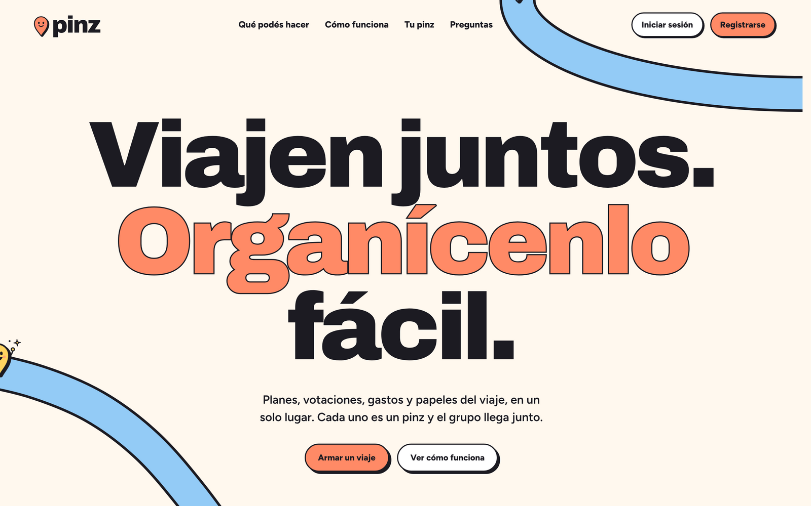
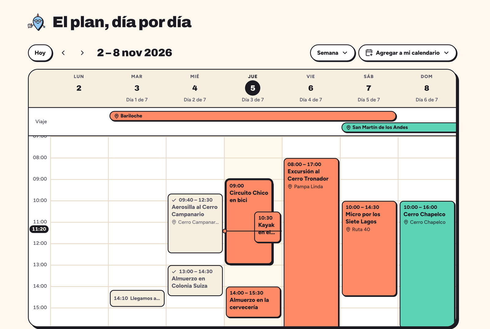

<div align="center">
  <picture>
    <source media="(prefers-color-scheme: dark)" srcset="./docs/img/pinz-logo-blanco.svg">
    
  </picture>
  <p><b>Viajen juntos. Organícenlo fácil.</b></p>
</div>
<br>
<p align="center">
  <a href="https://www.typescriptlang.org/docs/">
  
  </a>
  <a href="https://react.dev/">
  
  </a>
  <a href="https://vite.dev/guide/">
  
  </a>
  <a href="https://tailwindcss.com/docs/">
  
  </a>
  <a href="https://expressjs.com/">
  
  </a>
  <a href="https://www.mongodb.com/docs/">
  
  </a>
  <a href="https://docs.docker.com/">
  
  </a>
  <a href="https://www.openstreetmap.org/">
  
  </a>
</p>


# 📖 Introducción

**Pinz** es una app web para **organizar viajes en grupo**. Reúne en un solo lugar los planes, las votaciones, los gastos y los papeles del viaje. Cada persona del grupo elige su *pinz*, un personaje con forma de pin que la representa en el mapa y en toda la app.

La app acompaña las tres etapas de un viaje: **antes** (votar destino y alojamiento, armar el itinerario y repartirse las tareas), **durante** (el plan del día, el grupo en el mapa y los gastos cargados en el momento) y **después** (las cuentas simplificadas para quedar a mano y los lugares recorridos).

El proyecto tiene un front en `React` con `Vite` y una API en `Express` con `MongoDB`, todo en `TypeScript` y levantado con `Docker`.

## 🔑 Funcionalidades

- **Viajes en grupo con roles**: quien organiza puede cambiar roles, y cada persona es *organizador*, *miembro* o *lector* (solo consulta). Si alguien deja el viaje, sale del grupo como en un chat.

- **Invitaciones**: al viaje se suman personas con un link, un código, un QR o una invitación por mail.

- **Votaciones**: se vota destino, fechas, alojamiento, actividades o comida, y la opción ganadora pasa sola al plan.

- **Agenda**: el itinerario en vista de día, semana o mes, con cada destino como una cinta de color y las actividades que se pisan, una al lado de la otra. Se suscribe a **Google Calendar** o al **calendario del iPhone** y se actualiza sola.

- **Cuentas**: gastos divididos en partes iguales o por consumo, propina, pagos que se confirman y saldos simplificados para quedar a mano. Los tickets se pueden escanear con IA.

- **Listas y Baúl**: checklists personales y grupales, lo que cada uno tiene que llevar, los requisitos y un baúl para pasajes, vouchers y seguros.

- **Durante el viaje**: qué toca hoy, el grupo en el mapa y los teléfonos de emergencia del país donde están.

- **Mapas sin claves**: mapas de `OpenStreetMap` con `Leaflet` y búsqueda de lugares con `Nominatim`, sin facturación ni API keys.

- **Ingreso**: con Google o con un código que llega por mail.

- **Panel de administración**: `/admin`, reservado a `pinz.tesis@gmail.com`, para responder las consultas de "Escribinos" y ver resúmenes, usuarios y viajes. La API valida el correo de la sesión en cada ruta administrativa.

- **Tema claro y oscuro**.

## 🖥️ Tecnologías

- **Frontend**: `React 19`, `Vite`, `Tailwind CSS 4`, `React Router`, `TanStack Query`, `zod`, `Leaflet` y `lucide-react`.

- **Backend**: `Node.js` con `Express 5`, `Mongoose`, `zod`, sesión con un JWT en cookie (`jose`), `nodemailer` y `multer`.

- **Base de datos**: `MongoDB 7` en Docker para desarrollo o un cluster de `MongoDB Atlas` compartido por el equipo.

- **Contenedores**: `Docker Compose` levanta la base, la API y la web con recarga en caliente.

- **Integraciones**: login con `Google OAuth`, mails por `Gmail SMTP`, lectura de tickets con la API de `Claude` y calendario en formato `.ics`.

### ¿Por qué MongoDB?

Un viaje se lee y se edita casi siempre completo. En Pinz es un solo documento que guarda adentro sus miembros, destinos, votaciones, itinerario y gastos, así que la app lo trae en una consulta, sin uniones entre tablas. Lo que vive aparte (usuarios, documentos del Baúl, ubicaciones compartidas y consultas) va en sus propias colecciones. El esquema flexible nos dejó sumar campos mientras la app crecía, y `zod` junto con `Mongoose` validan cada dato antes de guardarlo.

## 🗂️ Estructura

```
.
├── api/                  # API en Express + Mongoose
│   └── src/
│       ├── rutas/        # Viajes, itinerario, gastos, listas, votaciones, admin…
│       ├── modelos/      # Viaje, Usuario, Documento, Consulta…
│       ├── calendario/   # Armado del .ics para Google Calendar y el iPhone
│       ├── cuentas/      # Saldos, pagos y migración de Cuentas
│       └── correo/       # Encabezados de los mails
├── web/                  # Front en React + Vite
│   └── src/
│       ├── pages/        # Landing, viajes, viaje (Agenda, Listas, Cuentas, Baúl), admin…
│       ├── components/   # UI, marca, calendario, landing y slots
│       └── pinz/         # Los personajes
├── docs/                 # Specs (por ejemplo, cuentas.md)
├── docker-compose.yml
└── .env.example
```


## 📝 Requisitos

### Instalar Docker

Hace falta **Docker Desktop** con **Docker Compose**. Se descarga [acá](https://docs.docker.com/get-started/get-docker/).

1. **Windows**: Docker Desktop necesita WSL 2. En PowerShell como administrador:

    ``` powershell
    wsl --install
    ```

    Reiniciá la computadora y después instalá Docker Desktop. Si aparece un error de *Virtual Machine Platform*, hay que activar la virtualización en la BIOS.

2. **Linux (Ubuntu)**: desde la terminal:

    ``` bash
    sudo apt update
    sudo apt install -y ca-certificates curl gnupg

    sudo install -m 0755 -d /etc/apt/keyrings
    curl -fsSL https://download.docker.com/linux/ubuntu/gpg | sudo gpg --dearmor -o /etc/apt/keyrings/docker.gpg

    echo \
      "deb [arch=$(dpkg --print-architecture) signed-by=/etc/apt/keyrings/docker.gpg] https://download.docker.com/linux/ubuntu \
      $(lsb_release -cs) stable" | sudo tee /etc/apt/sources.list.d/docker.list > /dev/null

    sudo apt update
    sudo apt install -y docker-ce docker-ce-cli containerd.io docker-buildx-plugin docker-compose-plugin
    ```

3. Verificá que quedó instalado:

    ``` bash
    docker --version
    docker compose version
    ```

## ⚙️ Instalación

1. **Clonar el repositorio**

    ``` bash
    git clone https://github.com/TESISTIMEXOXO/tesisomg.git
    cd tesisomg
    ```

2. **Crear el `.env`** a partir del ejemplo:

    ``` bash
    # Windows (PowerShell)
    Copy-Item .env.example .env

    # macOS / Linux
    cp .env.example .env
    ```

3. **Levantar todo**

    ``` bash
    docker compose up -d --build
    ```

    Para verificar que los tres contenedores (`db`, `api` y `web`) están corriendo, usá `docker compose ps`. Para ver qué pasa adentro de cada uno, usá `docker compose logs -f api` o `docker compose logs -f web`.

| Servicio | Dirección |
|:---|:---|
| Web | http://localhost:5173 |
| API | http://localhost:4000 |
| MongoDB local | `localhost:27017` |

> [!TIP]
>
> Después de cambiar el `.env`, alcanza con `docker compose up -d` para que los contenedores tomen los valores nuevos.

# 🌐 Variables de entorno

La configuración va en un archivo `.env` en la raíz del repo, al lado de `docker-compose.yml`.

**variables de entorno**

``` env
# .env

# mongo: vacía usa el Mongo local de Docker
MONGODB_URI=<uri de MongoDB Atlas>

# solo para el Mongo local (cuando MONGODB_URI está vacía)
MONGO_USER=<usuario>
MONGO_PASSWORD=<contraseña>
MONGO_DB=<nombre>

# sesión: obligatoria en producción
SESION_SECRETO=<secreto>

# google: para iniciar sesión con Google
GOOGLE_CLIENT_ID=<client id>
GOOGLE_CLIENT_SECRET=<client secret>

# mail: Gmail SMTP con contraseña de aplicación
SMTP_URL=smtp://<usuario>%40gmail.com:<contraseña de aplicación>@smtp.gmail.com:587
MAIL_FROM="Pinz <cuenta@gmail.com>"
CONTACTO_EQUIPO=<mail que recibe las consultas>

# claude: lectura de tickets en Cuentas
ANTHROPIC_API_KEY=<key>

# calendario: URL pública de la API, con https en producción
API_URL_PUBLICA=<url>
```

> Para ver qué hace cada variable, mirá los comentarios del [archivo de ejemplo](./.env.example).

Para probar en local se puede dejar todo vacío. La app usa el Mongo de Docker y, sin `SMTP_URL`, el código de ingreso aparece en los logs de la API. Lo que falte se desactiva con un aviso: sin `GOOGLE_CLIENT_ID` no hay ingreso con Google y sin `ANTHROPIC_API_KEY` el botón de escanear tickets avisa que no está disponible.

Para que el equipo comparta los mismos viajes, todos ponen en `MONGODB_URI` la URI del mismo cluster de MongoDB Atlas.

> [!Important]
>
> Nunca subas el `.env` real a GitHub. La URI de Atlas, las credenciales de Google y la contraseña de aplicación de Gmail se pasan por un medio privado.

# 🚀 Uso

1. Revisá que el `.env` esté configurado. Para más detalles, mirá la sección [Variables de entorno](#-variables-de-entorno).
2. Verificá que **Docker** esté corriendo y que los contenedores estén arriba. Para levantarlos, mirá la sección [Instalación](#%EF%B8%8F-instalación).
3. Entrá a http://localhost:5173 y registrate con tu mail. Si no configuraste `SMTP_URL`, el código de ingreso aparece en:

    ``` bash
    docker compose logs -f api
    ```
4. Si todo anda bien, en el navegador vas a ver la landing:



Una vez adentro, creá un viaje y sumá al grupo. Así se ve la Agenda de un viaje (con datos de ejemplo):



### Comandos útiles

| Para | Comando |
|:---|:---|
| Correr los tests de la API | `docker compose exec api npm test` |
| Revisar el código del front | `docker compose exec web npm run lint` |
| Compilar el front | `docker compose exec web npm run build` |
| Migrar los datos de Cuentas (una vez por base) | `docker compose exec api npm run migrar:cuentas` |
| Apagar todo | `docker compose down` |

> [!Warning]
>
> `docker compose down -v` también borra los volúmenes, y con ellos todos los datos del Mongo local.

# 📜 Licencia

© 2026 Mora Perez, Ignacio Lederhos y Tobias. **Todos los derechos reservados.** No se permite usar, copiar, modificar ni distribuir el código, el diseño ni las imágenes sin autorización escrita de los autores. Para más detalles, mirá el archivo [LICENSE](./LICENSE).

# 👥 Autores

| [<br><sub>Mora Perez</sub>](https://github.com/mirapxoxo) | [<br><sub>Ignacio Lederhos</sub>](https://github.com/ignaciolede) | [<br><sub>Tobias</sub>](https://github.com/Tobiasmb7)
|:---:|:---:|:---:|
